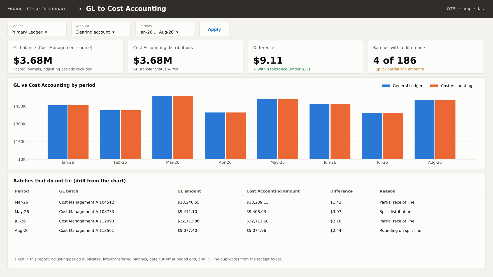

# Oracle OTBI Work

Two pieces of Oracle Transactional Business Intelligence (OTBI) work: a finance close dashboard, and the real report fix that shaped it.

## 1. Finance Close Dashboard → [`otbi-dashboards/`](otbi-dashboards/)

Two dashboard pages, **GL to Cost Accounting reconciliation** and **Payables aging**, built from four logical SQL analyses on standard Fusion subject areas, with shared prompts.

## 2. GL reconciliation case study → [`gl-reconciliation-case-study/`](gl-reconciliation-case-study/)

A cost accounting report that did not tie to the General Ledger. I found four causes (adjusting-period duplicates, transfer date filter, end-of-period cut-off, duplicate PO lines), fixed them, and brought a large gap down to a few dollars.

## Skills shown

OTBI analyses and dashboards · Logical SQL · Presentation variables and prompts · GL reconciliation · Python (pandas) for checking exports

> All screenshots use made-up data. No client names, account numbers or real amounts are included.
