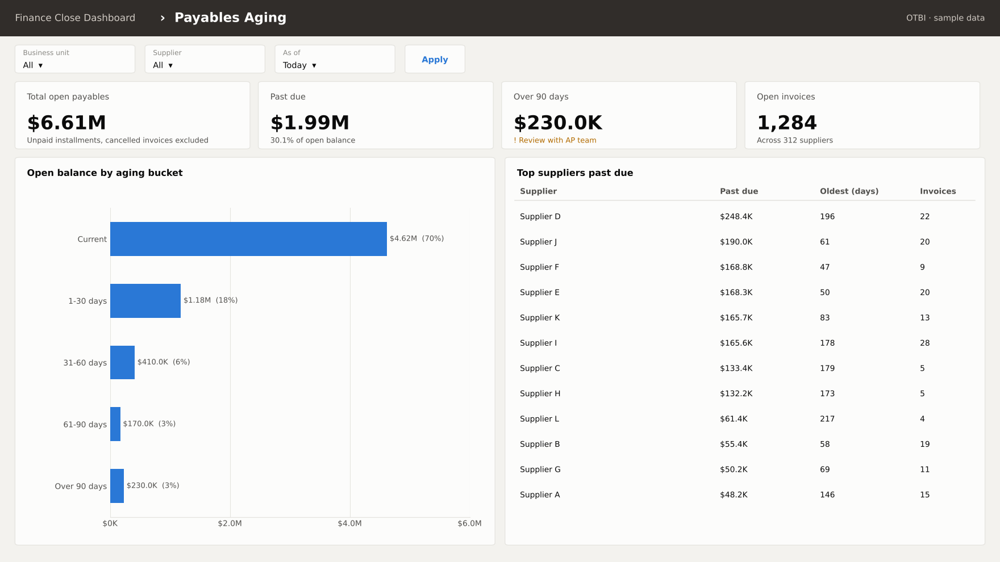

# Finance Close Dashboard (Oracle OTBI)

An OTBI dashboard for month-end close, with two pages: **GL to Cost Accounting reconciliation** and **Payables aging**. It is built from four OTBI analyses on standard Oracle Fusion subject areas.

> The screenshots are drawn from **made-up data** (`scripts/render_dashboard_preview.py`) to show the layout and logic. No real ledger, supplier or amount is shown.

## Page 1: GL to Cost Accounting

- **Prompts:** Ledger, Account, Periods (a period list, not a date range, so the cut-off matches the GL)
- **Tiles:** GL balance, Cost Accounting total, the difference with a tolerance check, and the number of batches that don't tie
- **Chart:** GL vs Cost Accounting side by side for each period
- **Drill table:** every batch that doesn't tie, with the reason

## Page 2: Payables aging

- **Tiles:** total open payables, past due, over 90 days, number of open invoices
- **Chart:** open balance by aging bucket
- **Table:** top suppliers past due, with the oldest item in days

## The analyses

| File | Subject area | Feeds |
|---|---|---|
| [`01_cost_accounting_to_gl_by_batch.lsql`](analyses/01_cost_accounting_to_gl_by_batch.lsql) | Costing - Cost Accounting Real Time | Page 1, Cost Accounting side and drill table |
| [`02_gl_journal_activity_by_source.lsql`](analyses/02_gl_journal_activity_by_source.lsql) | General Ledger - Journals Real Time | Page 1, GL side, by journal source |
| [`03_ap_open_invoices_aging.lsql`](analyses/03_ap_open_invoices_aging.lsql) | Payables Invoices - Transactions Real Time | Page 2, aging buckets with `TIMESTAMPDIFF` |
| [`04_project_cost_by_category.lsql`](analyses/04_project_cost_by_category.lsql) | Project Costing - Actuals Real Time | Optional project cost page |

The analyses use **presentation variables** (`@{p_periods}`, `@{p_account}`, `@{p_ledger}`, `@{p_bu}`), so one set of dashboard prompts drives every analysis on the page.

## How to build it in OTBI

1. **Reports and Analytics → Create → Analysis**, then choose the subject area from the table.
2. Open the **Advanced** tab and paste the logical SQL. Folder and column names can differ a little between Oracle releases. If one errors, re-add that column from the Criteria tab and keep the filters.
3. In each analysis, build the views shown in the screenshots: tiles (Performance Tile), bar chart, and table.
4. **Create → Dashboard**, add a **Dashboard Prompt** with presentation variables `p_ledger`, `p_account` and `p_periods`, then drag the analyses onto the page.
5. Save it in a **Shared Folder** so other users run the same version.

## Design choices

- Filter by **accounting period**, not a date range, so totals match the GL exactly.
- Exclude **adjusting periods** to avoid duplicate lines.
- Take PO details from the **Purchase Order** folder, not the receipt folder, which repeats lines.
- Show a **tolerance check** on the difference tile, so users know at a glance if the account ties.

## Tools

Oracle OTBI · Logical SQL · Dashboard prompts and presentation variables · Oracle Fusion General Ledger, Payables, Cost Management and Project Costing
